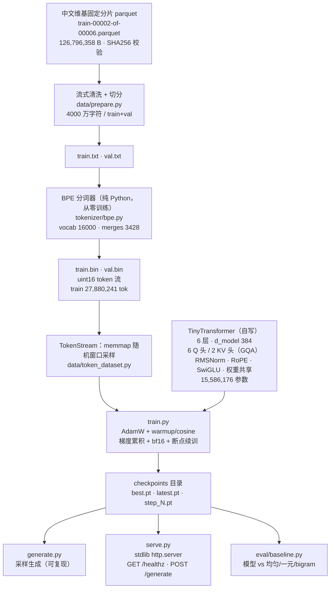

# tiny-llm-from-scratch

> 用 **纯 PyTorch** 从零实现一个中文 decoder-only 语言模型：**自己训分词器、自己写 Transformer、自己写训练循环、自己写采样与 HTTP 服务**。
> 不加载任何预训练权重，不使用 `transformers` / `tokenizers` / `tiktoken` / `sentencepiece`，也不使用任何 Web 框架。

---

## 1. 这个项目解决什么问题

大模型 API 让人「用上」模型，却不让人「看懂」模型。这个仓库把一个语言模型从数据到接口的**完整链路**摊开写出来，让每一步都能被逐行阅读、被单测覆盖：

- **分词器不是黑盒**：BPE 合并规则怎么学出来的、`encode → decode` 为什么能保证逐字往返无损、UNK 从哪来；
- **Transformer 不是调用库**：RMSNorm / RoPE / GQA / SwiGLU / 权重共享 / KV cache 全部是自己写的 `torch.nn` 子模块，不 import 任何 HuggingFace 组件；
- **训练不是脚本黑箱**：AdamW + warmup/cosine、梯度累积、bf16 autocast、OOM 自适应、checkpoint 断点续训，全部有实现和单测；
- **服务不是 demo**：checkpoint → 可被调用的 HTTP 接口，只用 Python 标准库 `http.server`，零新依赖。

一句话定位：**这是一个「可以从头复现一遍」的最小中文语言模型仓库** —— 15.6M 参数 / 512 上下文 / 2788 万训练 token，全部从原始 parquet 开始自己造。

---

## 2. 从零实现了什么

| 能力 | 实现细节 | 源码路径 |
|---|---|---|
| **BPE 分词器** | 纯 Python 实现；用「字符类别分段」（汉字串 / 拉丁串 / 数字串 / 单字符）替代空格分词，让中文可合并；增量式 pair 统计（`pair → 词下标集合`）+ 堆取最高频 pair，并列时按字典序取小者 → **训练结果完全可复现** | `tokenizer/bpe.py` |
| **分词器训练与自检** | 从语料学合并规则；落盘后统计 UNK 率、tokens/char、**往返无损**（抽样行 `decode(encode(x)) == x`） | `tokenizer/train_bpe.py` |
| **decoder-only Transformer** | Pre-Norm 残差结构；6 层，每层 `RMSNorm → 因果自注意力 → RMSNorm → SwiGLU FFN` | `model/transformer.py` |
| ├ **RMSNorm** | `x / sqrt(mean(x²) + eps) * weight`，去掉均值中心化 | `model/transformer.py: RMSNorm` |
| ├ **RoPE** | 按 head 维度对 q/k 做旋转位置编码，带 cos/sin 缓存 | `model/transformer.py: build_rope_cache / apply_rope` |
| ├ **GQA（分组查询注意力）** | `n_kv_head < n_head` 时走 `enable_gqa`，省 KV cache 显存；KV 头数 == 头数时退化为标准 MHA | `model/transformer.py: CausalSelfAttention` |
| ├ **SwiGLU FFN** | `down(silu(gate(x)) * up(x))`，三矩阵代替两矩阵 | `model/transformer.py: SwiGLU` |
| ├ **Embedding / LM Head 权重共享** | `lm_head.weight is tok_emb.weight`（同一对象，不复制） | `model/transformer.py: TinyTransformer.__init__` |
| └ **残差投影缩放初始化** | GPT-2 风格 `1/sqrt(2L)` 缩放 `o_proj` / `down_proj` | `model/transformer.py: TinyTransformer.__init__` |
| **训练循环** | AdamW（参数分组：2D 参数 wd=0.1，1D/归一化 wd=0）+ warmup + cosine 衰减 + 梯度裁剪 | `train.py` |
| ├ **梯度累积** | `micro_batch × grad_accum = 有效 batch`，等效 batch 不变 | `train.py: run_micro_steps` |
| ├ **bf16 autocast** | GPU 支持时自动启用 `torch.bfloat16` autocast，loss 仍以 fp32 计算 | `train.py` |
| ├ **OOM 自适应** | OOM 时先开梯度检查点，再把 micro-batch 减半重跑；**丢弃本轮已累积梯度**避免梯度污染 | `train.py` |
| ├ **checkpoint / 断点续训** | `latest.pt` 存模型 + 优化器 + 调度器 + step + tokens_seen + **RNG 状态**；`--resume auto` 原地续训 | `train.py` |
| └ **可观测** | `results/train_log.csv`、`results/val_log.csv`（CSV），训练结束写 `results/train_summary.json` | `train.py` |
| **采样** | temperature / top-k / top-p(nucleus)，支持固定种子 → **同参数同输出** | `model/sampling.py` |
| **自回归生成** | KV cache 增量解码（O(T) 而非 O(T²)）+ 左侧 padding + 显式 attention mask | `model/generation.py` |
| **HTTP 生成服务** | **只用标准库** `http.server.ThreadingHTTPServer`；`GET /healthz`、`POST /generate`；生成用锁串行化保证线程安全；1MB 请求体上限 | `serve.py` |
| **评测与基线** | 模型 vs 均匀 / 一元 / bigram 三条基线；基线统计走**训练集**、评测走**验证集**，且与模型在**完全相同的 token 位置**上比对 | `eval/baseline.py` |
| **单测** | 37 条 pytest：形状 / 参数量 / 权重共享 / 因果性 / 梯度能流 / KV cache 一致性 / 往返无损 / 采样可复现 / 训练降 loss | `tests/` |

---

## 3. 架构图



单个 Transformer Block 的内部结构（Pre-Norm，残差在子层外侧）：

```
x ──→ [ RMSNorm → Attn(GQA + RoPE) → o_proj ] ──┐
     └────────────────────────────────────────────( ⊕ )──→ x

x ──→ [ RMSNorm → SwiGLU → down_proj ] ─────────┐
     └────────────────────────────────────────────( ⊕ )──→ x
```

---

## 4. 快速开始

### 4.1 环境

本仓库**不要求** conda / 特定 venv，仓库 `requirements.txt` 里只有 5 个第三方包（torch / numpy / pyarrow / matplotlib / pytest），其中 `torch` 是唯一重型依赖。

| 项 | 值 |
|---|---|
| 解释器 | `C:\Users\田梦龙\AppData\Local\Programs\Python\Python312\python.exe`（Python 3.12.9） |
| PyTorch | `2.14.0+cu132`（本机已装，**不要重装/升级**） |
| GPU | NVIDIA GeForce RTX 5060 Laptop GPU（8GB） |
| 其余依赖 | `numpy>=2.0`、`pyarrow>=15.0`（读 parquet）、`matplotlib>=3.8`（画曲线）、`pytest>=8.0` |

装依赖（若本机已装好 torch，可跳过 `torch==2.14.0` 那一行避免动到 CUDA 环境）：

```powershell
cd D:\programmer\LLM\projects\tiny-llm-from-scratch
& "C:\Users\田梦龙\AppData\Local\Programs\Python\Python312\python.exe" -m pip install -r requirements.txt
```

### 4.2 四步命令序列

以下命令在仓库根目录执行。设 `$PY = "C:\Users\田梦龙\AppData\Local\Programs\Python\Python312\python.exe"`。

#### ① 语料准备（下载 → 清洗切分 → 训分词器 → 编码 token 流）

```powershell
# 1a. 下载中文维基固定分片（126.8 MB，自动校验官方 SHA256）并流式清洗切分
& $PY data/prepare.py --source wiki --max-chars 40000000

# 1b. 在 train.txt 上训练 BPE 分词器（纯 Python，约 15.5s），产出 tokenizer/artifacts/tokenizer.json
& $PY tokenizer/train_bpe.py --train data/processed/train.txt --vocab-size 16000

# 1c. 用已训练的分词器把 train/val 文本编码成 uint16 token 流
& $PY data/prepare.py --tokenize
```

> **网络提示**：`data/prepare.py` 的 `--proxy` 默认取环境变量 `HTTPS_PROXY`，取不到则回落到 `http://127.0.0.1:7897`。
> 无代理环境请先清掉环境变量再显式传空串（PowerShell 7 可正常传递空参数；Windows PowerShell 5.1 会丢弃空串，此时请改用 `--proxy <你的代理地址>`）：
> ```powershell
> $env:HTTPS_PROXY=$null; $env:HTTP_PROXY=$null
> & $PY data/prepare.py --source wiki --max-chars 40000000 --proxy ""
> ```
> 完全离线退路：`--source local`（扫描本机已有中文文本，规模小得多，产物里会如实记录来源）。

产物：`data/processed/{stats.json, token_stats.json, train.txt, val.txt, train.bin, val.bin}`、`tokenizer/artifacts/tokenizer.json`、`results/tokenizer_stats.json`。

#### ② 训练

```powershell
& $PY train.py `
  --batch-size 16 --micro-batch 8 --grad-accum 2 `
  --seq-len 512 --max-steps 12000 `
  --lr 3e-3 --warmup-steps 200 --weight-decay 0.1 --grad-clip 1.0 `
  --eval-every 500 --eval-batches 20 --log-every 25 --save-every 1000 `
  --seed 1337 --max-hours 1.2
```

- 有效 batch = `micro_batch 8 × grad_accum 2 = 16`；每 step 消费 `16 × 512 = 8192` token。
- 中断后原地续训：`& $PY train.py --resume auto --max-steps 12000 ...`（恢复模型 + 优化器 + 调度器 + RNG 状态）。
- 只加载权重不恢复优化器：`--init-from checkpoints/best.pt`。
- 画训练曲线（可选）：`& $PY scripts/plot_training.py --results-dir results --out results/training_curve.png`。

#### ③ 采样生成

```powershell
& $PY generate.py --ckpt checkpoints/best.pt --num 8 --max-new-tokens 60 --temperature 0.8 --top-k 50 --top-p 0.95
```

产物：`results/generations.json` / `results/generations.txt`（含 8 条 prompt + 续写）。

#### ④ 起 HTTP 服务

```powershell
& $PY serve.py --ckpt checkpoints/best.pt --host 127.0.0.1 --port 8000
```

另开一个终端验证：

```powershell
# 健康检查
curl.exe http://127.0.0.1:8000/healthz

# 生成
curl.exe -X POST http://127.0.0.1:8000/generate `
  -H "Content-Type: application/json" `
  -d '{"prompt":"维基百科是","max_new_tokens":40,"temperature":0.8,"top_k":50,"top_p":0.95,"seed":1234}'
```

#### 附：评测与单测

```powershell
# 模型 vs 均匀 / 一元 / bigram 基线（产出 results/eval_report.json + eval_report.md）
& $PY eval/baseline.py --ckpt checkpoints/best.pt

# 只算基线（还没训完也能跑）
& $PY eval/baseline.py --skip-model

# 单测
& $PY -m pytest tests -q
```

---

## 5. 实测指标

> **数据来源**：模型结构来自 `model/transformer.py` 与 `checkpoints/*/config`；语料与分词统计来自 `data/processed/stats.json`、`data/processed/token_stats.json`、`results/tokenizer_stats.json`；训练参数来自 `checkpoints/latest.pt` 内嵌的 `args`；训练曲线来自 `results/train_log.csv`、`results/val_log.csv`。
> **本机环境**：RTX 5060 Laptop GPU 8GB / PyTorch 2.14.0+cu132 / Python 3.12.9。

### 5.1 模型结构

| 指标 | 数值 | 来源 |
|---|---|---|
| **实际参数量（唯一权重）** | **15,586,176**（≈15.59M） | `model.num_parameters()` / `parameter_breakdown()` |
| 其中 Token Embedding | 6,144,000（= 16000 × 384） | 同上 |
| 其中非 Embedding | 9,441,792 | 同上 |
| 每层参数量 | 1,573,632（× 6 层） | 同上 |
| `state_dict` 键数 | 57 | `checkpoints/best.pt` |
| `state_dict` 逐键 `numel` 相加 | 21,730,176 —— **比实际参数量多 6,144,000** | 多出的部分正是 `lm_head.weight` 与 `tok_emb.weight` **共享的同一份权重被重复计入**（两者是同一个 Tensor 对象） |
| 词表大小 | 16,000 | `ModelConfig.vocab_size` / `data/processed/token_stats.json` |
| 层数 | 6 | `ModelConfig.n_layer` |
| 注意力头 | 6 个 Query 头 / 2 个 KV 头（GQA，`n_rep = 3`），head_dim = 64 | `ModelConfig.n_head / n_kv_head` |
| 隐藏维度 | `d_model = 384`，FFN 中间维 `d_ff = 1024` | `ModelConfig` |
| **上下文长度** | **512** token（`max_seq_len`） | `ModelConfig.max_seq_len` |
| 权重 dtype | fp32（bf16 只用于 autocast 前向/反向计算） | `checkpoints/best.pt` state_dict dtype |

### 5.2 语料与分词器

| 指标 | 数值 | 来源 |
|---|---|---|
| 语料来源 | `wikimedia/wikipedia`，config `20231101.zh`，固定 commit `b04c8d1ceb2f5cd4588862100d08de323dccfbaa` | `data/processed/stats.json` |
| 分片 | `train-00002-of-00006.parquet`，126,796,358 B，SHA256 与官方公布值一致 | `data/processed/stats.json` |
| 语料许可 | CC BY-SA 4.0 (Wikipedia) | `data/processed/stats.json` |
| 清洗后字符数 | 40,000,000 | `data/processed/stats.json` |
| 行数 | train 1,464,460 / val 7,383 | `data/processed/stats.json` |
| 文本大小 | train.txt 96.21 MiB / val.txt 493.2 KiB | 文件实测 |
| **训练 token 数** | **27,880,241**（train）/ 139,353（val） | `data/processed/token_stats.json` |
| tokens / char | 0.7273 | `data/processed/token_stats.json` |
| UNK 率 | train 0.0 / val 8.61e-05 | `data/processed/token_stats.json` |
| BPE 词表构成 | base 字符 12,568 + merges 3,428 → **16,000** | `results/tokenizer_stats.json` |
| BPE 学习规模 | 1200 万字符 / 12 万词类型 / 训练 15.51 s | `results/tokenizer_stats.json` |
| 往返无损 | 抽样 2,929 行校验，**0 处不一致**（`roundtrip_lossless = true`） | `results/tokenizer_stats.json` |
| token 流大小 | train.bin 53.18 MiB / val.bin 272.2 KiB（uint16） | 文件实测 |

### 5.3 训练

| 指标 | 数值 | 来源 |
|---|---|---|
| 实际执行的训练参数 | `batch_size 16`、**`micro_batch 8` × `grad_accum 2`**、`seq_len 512`、`lr 3e-3`、`warmup 200`、`weight_decay 0.1`、`betas (0.9, 0.95)`、`grad_clip 1.0`、`seed 1337`、bf16 开启 | `checkpoints/latest.pt` 的 `args` |
| 调度 | warmup 200 步线性升到 3e-3，之后 cosine 衰减到 `min_lr_ratio 0.05` | `train.py: build_lr_lambda` |
| **实际训练步数** | **7,500 步**（CLI 目标 `--max-steps 12000`，**未跑完**：进程在 step 7500 处被外部终止，因此没有生成 `results/train_summary.json`） | `results/train_log.csv` / `results/val_log.csv` |
| 每步 token | 8,192（= 16 × 512） | `train.py` |
| **累计训练 token** | **61,440,000** | `checkpoints/best.pt` 的 `tokens_seen` |
| **吞吐** | **71,875 tok/s**（step 7500 时）；全程峰值 76,190 tok/s | `results/train_log.csv` 的 `tok_per_s` |
| **峰值显存** | **1.67 GiB**（`torch.cuda.max_memory_allocated`，日志 300 行恒定未变） | `results/train_log.csv` 的 `mem_peak_gb` |
| 墙钟耗时 | 854.8 s ≈ **14.2 min**（到 step 7500） | `results/train_log.csv` 的 `elapsed_s` |
| 梯度检查点 | 未通过 CLI 启用（`--grad-checkpoint` 未加）；micro_batch 全程为 8，日志中无 OOM 减半 | `checkpoints/latest.pt` 的 `args` / `results/train_log.csv` |
| **train loss（首 → 末）** | **7.9884（step 25） → 2.7995（step 7500）**；全程最低 1.5102 | `results/train_log.csv` |
| **train PPL（首 → 末）** | **2,946.6 → 16.44**（由 `exp(train_loss)` 换算，仓库未直接记录 train PPL） | `results/train_log.csv` 换算 |
| **val loss / PPL（首 → 末）** | **4.8647 / 129.63（step 500） → 3.5965 / 36.47（step 7500）**，单调下降无反弹 | `results/val_log.csv` |

### 5.4 产物大小

| 文件 | 大小 | 内容 |
|---|---|---|
| `checkpoints/best.pt` | 62,363,073 B（**59.47 MiB**） | 仅权重（fp32）+ config + step + tokens_seen + val_loss/val_ppl；对应 **step 7500, val_ppl 36.47** |
| `checkpoints/latest.pt` | 187,113,747 B（**178.45 MiB**） | 权重 + 优化器 + 调度器 + RNG 状态；对应 **step 7000**（`--save-every 1000`） |
| `checkpoints/step_7000.pt` | 62,366,903 B（59.48 MiB） | 仅权重的历史 step 快照 |
| `tokenizer/artifacts/tokenizer.json` | 184,091 B（179.8 KiB） | 分词器（16,000 词条 + 3,428 条合并规则） |

> 权重体积核对：`15,586,176 × 4 B = 62,344,704 B`（纯 fp32 权重），`best.pt` 实测 62,363,073 B，差值 18.4 KB 即 config / step / tokens_seen / val_loss 等元信息。

### 5.5 本地实测（2026-10-21，RTX 5060 8GB）

以下数字由本人在本机实际跑出来的，**不是仓库里已归档的产物**：

| 项目 | 结果 | 复现命令 |
|---|---|---|
| 评测（模型 vs 三条基线） | 256 个验证窗口 / 131,072 个预测位置；模型 val_loss **3.5964**、val_ppl **36.47** | `& $PY eval/baseline.py --ckpt checkpoints/best.pt` |
| 单测 | **37 passed in 4.11s** | `& $PY -m pytest tests -q` |
| 采样生成 | 8 条样例 × 60 token，耗时 1.54 s（GPU，batch=8） | `& $PY generate.py --ckpt checkpoints/best.pt --num 8 --max-new-tokens 60` |
| HTTP 服务 | `GET /healthz` 返回 `{"status":"ok","model_params":15586176,"train_step":7500,"tokens_seen":61440000,...}`；`POST /generate` 正常返回续写 | `& $PY serve.py --ckpt checkpoints/best.pt --port 8000` |

> 评测跑的是 `checkpoints/best.pt`（step 7500），与训练日志中 step 7500 的 `val_loss = 3.596505` **完全一致**，说明评测协议（窗口切分、预测位置）与训练期验证窗口是对齐的。

---

## 6. 评测与基线对比

### 6.1 评测协议（诚实性约束）

- 基线统计**只用训练集**，评测**只在验证集**上做 —— 不拿验证集统计自己；
- 模型与所有基线在**完全相同的 256 个窗口 / 131,072 个预测位置**上打分，loss 才可比；
- 窗口切分规则与 `train.py` 内的验证窗口**逐字节一致**，所以训练日志里的 val loss 与本报告的 val loss 可以直接对上。

### 6.2 结果

| 方法 | 验证集 loss | 验证集 PPL | 说明 |
|---|---|---|---|
| 均匀分布基线 | 9.6803 | 16,000.00 | `P(t) = 1/V`，完全不看数据（= `ln(16000)`） |
| 一元（unigram）基线 | 7.2746 | 1,443.24 | 只看当前 token 的边缘频率 |
| 二元（bigram）基线 | 5.6345 | 279.92 | `P(t_{i+1} \| t_i)`，add-alpha(1.0) 平滑 |
| **本项目模型** | **3.5964** | **36.47** | 512 token 上下文，15,586,176 参数，step 7500 |

- vs 均匀分布：PPL 改善 **438.7×**
- vs 一元基线：PPL 改善 **39.6×**
- vs bigram 基线：PPL 改善 **7.68×**（loss 低 **2.038 nats**）

> **边界说明（重要）**：bigram 只有 **1 个 token** 的上下文，本模型有 **512 个**，两者信息量根本不对等。
> 「优于 bigram」证明的是「模型确实学到了语言结构、并利用了长上下文」，**不代表**它已经接近真实语料的分布水平。

### 6.3 仓库里已有的其他验证手段

| 手段 | 覆盖的环节 | 位置 |
|---|---|---|
| **单元测试（37 条）** | 前向形状、参数量与 breakdown、权重共享、**因果性**（改动未来 token 不影响过去 logits，GQA/MHA 两种配置都测）、梯度能流（每个参数拿到有效梯度）、RoPE 形状与旋转性质、RMSNorm 归一化、**KV cache 与整段前向结果一致**、参数量预算（<20M）、配置 JSON 往返、采样同种子可复现、批量生成中 padding 不影响结果 | `tests/test_model.py` |
| | 一步训练 loss 下降、单 batch 过拟合、梯度裁剪生效、top-k / top-p / temperature 行为、checkpoint 存取一致、**warmup→cosine 调度形状** | `tests/test_training.py` |
| | 预分词规则、长汉字串切块、**encode→decode 往返无损**、UNK 行为、词表规模区间、保存/载入后行为一致、**BPE 训练确定性**、合并规则按 rank 套用、特殊 token 解码跳过 | `tests/test_tokenizer.py` |
| **分词器自检** | 训练后自动统计 UNK 率、tokens/char、往返无损行数与不一致数 | `tokenizer/train_bpe.py` → `results/tokenizer_stats.json` |
| **语料自证** | 分片 SHA256 与官方公布值比对；train/val 文本 SHA256 落盘；token 流 SHA256 落盘 | `data/prepare.py` → `data/processed/{stats,token_stats}.json` |
| **训练可观测** | 每 25 步一行 CSV（loss / lr / grad_norm / micro_bs / tokens_seen / 吞吐 / 峰值显存）；每 500 步一行验证 CSV | `results/train_log.csv`、`results/val_log.csv` |
| **基线对照评测** | 三条基线 + 协议元信息落盘为 JSON 与 Markdown 报告 | `eval/baseline.py` → `results/eval_report.{json,md}` |
| **训练曲线作图** | train/val loss、困惑度、吞吐、显存四联图 | `scripts/plot_training.py`（⚠️ 当前只在本地工作区，尚未提交进 git） |

---

## 7. 已知边界

以下是**这个仓库做不到 / 没做到**的事，如实列出：

1. **单机单卡**。所有训练、评测、生成都只在**一块** RTX 5060（8GB）上跑过。没有做多卡数据并行 / 张量并行 / FSDP / DeepSpeed，也没有做 pipeline 并行。
2. **语料是单一中文维基固定分片**。只有 `train-00002-of-00006.parquet` 这一个分片、4000 万字符。没有多语料混合、没有去重、没有质量过滤（只做了格式清洗：去引用/表格/模板/裸 URL）。
3. **没有量化、没有推理优化**。权重是 fp32，没有做 int8/FP8/AWQ/GPTQ 量化，没有做 KV cache 量化，没有 speculative decoding，没有 FlashAttention 定制 kernel（用的是 PyTorch 自带的 `scaled_dot_product_attention`）。
4. **没有做生产能力验证**。HTTP 服务是**单进程 + 单把锁串行生成**，`ThreadingHTTPServer` 没有做连接池、限流、鉴权、请求超时、熔断；也没有做过压测。**生产环境绝对不能直接用这个服务。**
5. **PPL 之外的生成质量未系统评估**。没有做人工评测、没有做困惑度以外的任务评测（如 HellaSwag 类选择题）、没有做事实性 / 安全性评测、没有做与更大模型的主观对比。`generate.py` 产出的 8 条样例（本地 `results/generations.txt`）**只是能力示意，不是质量结论**。
6. **训练未跑完**。实际只跑到 step 7,500（目标 12,000），且**是被外部终止的**（不是正常收尾），所以没有 `results/train_summary.json`、没有学习率跑完 cosine 全程。val PPL 仍在单调下降，**继续训练大概率还能更好**。
7. **评测样本量偏小**。验证集只有 139,353 token（0.5% 的划分比例），评测窗口 256 个 / 131,072 个预测位置。PPL 数字在小样本上的置信度有限。
8. **上下文只有 512**，没有长上下文 / RoPE 外推 / NTK 插值之类的实验。
9. **分词器是字符级 base + 3428 条合并**，压缩率有限（0.727 token/字符），远不如字节级 BPE 的效率；词典外字符一律退化成 UNK。
10. **没有多语言、没有指令微调、没有 RLHF / DPO**，没有做任何对齐工作。
11. **依赖环境固定**。`requirements.txt` 里 `torch==2.14.0` 对应本机 `2.14.0+cu132`，换机器需要按自己的 CUDA 版本重装。
12. **算力没有用满**。batch 16 × seq 512 时峰值显存只用了 1.67 GiB，远未吃满 8GB —— 说明**还能开更大 batch / 更长序列 / 更大模型**，本仓库没有把这部分算力用起来。

---

## 8. 目录结构

```
tiny-llm-from-scratch/
├── data/                       # 语料流水线
│   ├── prepare.py              # 下载维基固定分片(SHA256校验) → 流式清洗 → 切分 → tokenize 阶段
│   ├── token_dataset.py        # TokenStream：uint16 token 流的 memmap 随机窗口采样器
│   ├── processed/              # [gitignore] stats.json / token_stats.json / train.txt / val.txt / *.bin
│   └── raw/                    # [gitignore] 下载的 parquet 分片
├── tokenizer/                  # 从零实现的 BPE 分词器
│   ├── bpe.py                  # 预分词 + 增量式 BPE 训练 + 编码/解码 + UNK
│   ├── train_bpe.py            # 训练脚本 + 往返无损 / UNK 率自检
│   └── artifacts/
│       └── tokenizer.json      # 词表 16000 + merges 3428
├── model/                      # 模型
│   ├── transformer.py          # RMSNorm / RoPE / GQA / SwiGLU / 权重共享 / TinyTransformer
│   ├── sampling.py             # temperature / top-k / top-p
│   └── generation.py           # KV cache 自回归生成 + 左侧 padding + attention mask
├── eval/
│   └── baseline.py             # 模型 vs 均匀 / 一元 / bigram 基线
├── scripts/
│   └── plot_training.py        # 训练曲线作图（⚠️ 尚未提交进 git）
├── tests/                      # pytest：37 条
│   ├── test_model.py
│   ├── test_training.py
│   └── test_tokenizer.py
├── results/                    # 指标与日志
│   ├── tokenizer_stats.json    # 分词器统计（已提交）
│   ├── train_log.csv           # 训练日志（本地，未提交）
│   ├── val_log.csv             # 验证日志（本地，未提交）
│   ├── train_summary.json      # 训练结束自动写出（本次训练被中断，尚未生成）
│   └── eval_report.{json,md}   # eval/baseline.py 输出
├── checkpoints/                # [gitignore] best.pt / latest.pt / step_N.pt
├── train.py                    # 训练脚本（AdamW + warmup/cosine + 梯度累积 + bf16 + 断点续训）
├── generate.py                 # 批量采样生成 CLI
├── serve.py                    # 零新依赖的 stdlib HTTP 生成服务
├── requirements.txt            # torch / numpy / pyarrow / matplotlib / pytest
└── README.md
```

> 仓库只追踪**代码与小型配置产物**（`tokenizer/artifacts/tokenizer.json`、`results/tokenizer_stats.json`）；
> 语料、token 流、checkpoint 由 `.gitignore` 排除（`data/raw/`、`data/processed/`、`checkpoints/`、`*.bin`、`*.pt`）；
> 训练日志 `results/train_log.csv`、`results/val_log.csv` 目前**尚未 commit 进 git**。

---

## 9. License

**暂未添加 License 文件。**

语料来源许可已单独记录在 `data/processed/stats.json`：`CC BY-SA 4.0 (Wikipedia)`。
`--source local` 退路路径使用的是本机自有内容（许可：`本地自有内容`）。
代码部分暂未声明开源许可 —— 若要复用请先联系作者确认授权。

---

## 附：一句话复现全流程

```powershell
cd D:\programmer\LLM\projects\tiny-llm-from-scratch
$PY = "C:\Users\田梦龙\AppData\Local\Programs\Python\Python312\python.exe"
& $PY data/prepare.py --source wiki --max-chars 40000000          # ① 语料
& $PY tokenizer/train_bpe.py --vocab-size 16000
& $PY data/prepare.py --tokenize
& $PY train.py --batch-size 16 --micro-batch 8 --grad-accum 2 --seq-len 512 --max-steps 12000   # ② 训练
& $PY generate.py --ckpt checkpoints/best.pt --num 8 --max-new-tokens 60                      # ③ 采样生成
& $PY serve.py --ckpt checkpoints/best.pt --port 8000                                        # ④ HTTP 服务
```
